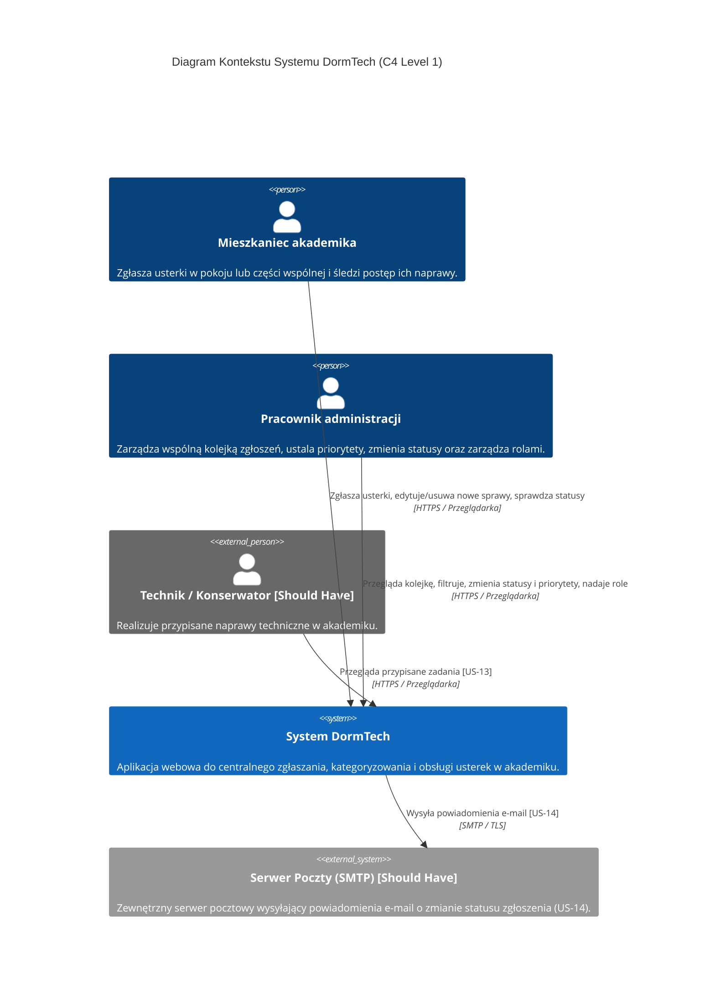
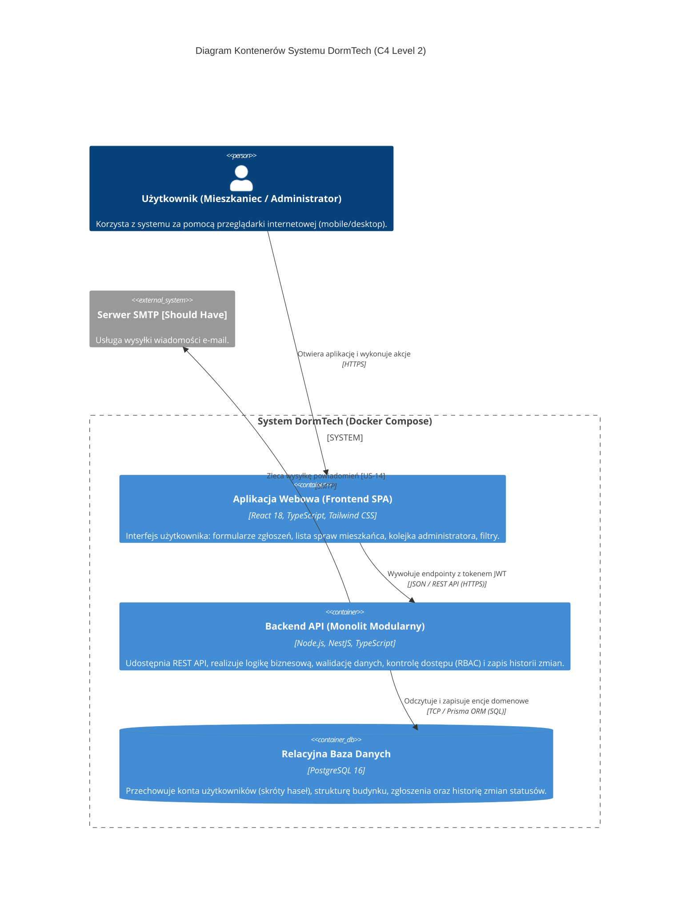
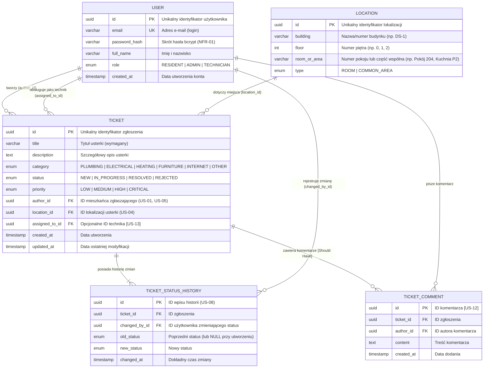
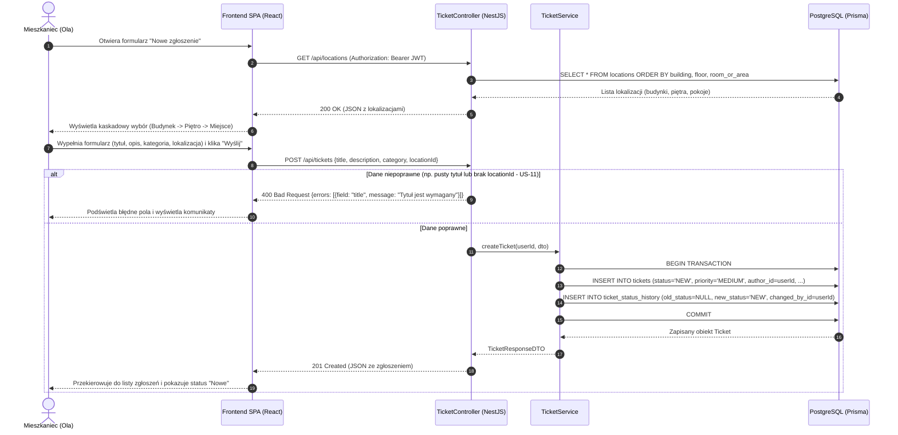
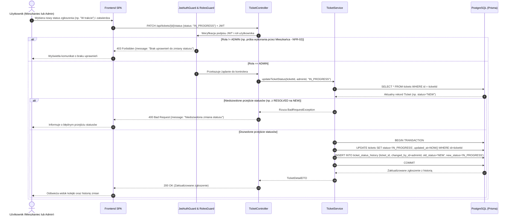

# DormTech — Dokument Architektury Systemu

**Zespół DMKSO**  
**Wersja dokumentu:** 1.0  
**Baza wymagań:** `Analiza_Wymagan.md` (priorytety MoSCoW)

---

## 1. Wprowadzenie i cel dokumentu

Niniejszy dokument opisuje architekturę systemu **DormTech** – aplikacji webowej służącej do zgłaszania, kategoryzowania i obsługi usterek w akademiku. Architektura została zaprojektowana tak, aby w pierwszej kolejności zrealizować wszystkie wymagania kategorii **Must Have (US-01 – US-11)** oraz wymagania niefunkcjonalne (**NFR-01 – NFR-06**), a jednocześnie pozostać otwartą na bezbolesne wdrożenie funkcji **Should Have** (komentarze, przypisywanie techników, powiadomienia e-mail) i **Could Have** (statystyki).

Wszystkie diagramy zamieszczone w dokumencie (zapisane w notacji Mermaid) odzwierciedlają docelową strukturę katalogów, encji bazy danych oraz kontraktów API, zapewniając 100% zgodności z kodem źródłowym.

---

## 2. Styl architektury i uzasadnienie

### Wybrany styl: **Monolit modularny (Modular Monolith) z architekturą warstwową i rozdzielonym frontendem SPA (Client-Server REST API)**

#### Uzasadnienie wyboru:
1. **Adekwatność do skali projektu i zespołu (MVP):** System obsługuje użytkowników pojedynczego akademika lub kampusu (rzędu kilkuset użytkowników i setek zgłoszeń miesięcznie). Rozbijanie systemu na mikroserwisy wprowadziłoby zbędny narzut operacyjny (rozproszone transakcje, orkestracja, opóźnienia sieciowe) bez korzyści biznesowych.
2. **Łatwość uruchomienia i odbioru (NFR-04):** Monolit backendowy połączony z pojedynczą bazą danych pozwala na uruchomienie całego środowiska jednym poleceniem (`docker compose up`), co gwarantuje spełnienie wymogu prostego startu ze świeżego klonu repozytorium.
3. **Wyraźny podział odpowiedzialności (Separation of Concerns):** Backend podzielony jest na niezależne moduły domenowe (`auth`, `users`, `locations`, `tickets`), a wewnątrz każdego z nich na warstwy: **Kontrolerów (API) $\rightarrow$ Serwisów (Logika biznesowa i RBAC) $\rightarrow$ Repozytoriów (Dostęp do danych)**.
4. **Gotowość na rozbudowę (Should/Could Have):** Modułowa budowa pozwala w przyszłości łatwo dopisać obsługę komentarzy (`US-12`), przypisywanie techników (`US-13`) czy moduł raportowy (`US-15`) bez refaktoryzacji istniejącego rdzenia.

---

## 3. Stos technologiczny i uzasadnienie

| Warstwa | Technologia | Uzasadnienie wyboru |
| --- | --- | --- |
| **Frontend (SPA)** | **React 18 + TypeScript + Vite + Tailwind CSS** | React z TypeScriptem zapewnia silne typowanie (spójność kontraktów DTO z backendem) i reużywalność komponentów formularzy (kluczowe dla walidacji `US-11`). Tailwind CSS ułatwia zbudowanie responsywnego interfejsu bez przewijania poziomego dla szerokości `360px` i `1280px` (`NFR-06`). |
| **Backend (API)** | **Node.js + NestJS (TypeScript)** *(alternatywnie: Python + FastAPI)* | **NestJS** narzuca czystą, modularną architekturę (moduły, kontrolery, serwisy, strażnicy `Guards`), posiada wbudowaną walidację żądań (`class-validator` dla `US-11`) oraz natywnie generuje dokumentację OpenAPI/Swagger. Wspólny język (TypeScript) na froncie i backendzie przyspiesza pracę zespołu. |
| **Baza danych** | **PostgreSQL 16** | Relacyjna baza danych gwarantująca integralność referencyjną (klucze obce między użytkownikiem, lokalizacją, zgłoszeniem a historią statusów – `NFR-03`) oraz wysoką wydajność zapytań filtrujących (`US-10`, `NFR-05`). |
| **ORM / Migracje** | **Prisma ORM** | Deklaratywny schemat bazy danych (`schema.prisma`), automatyczne i powtarzalne migracje oraz pełne bezpieczeństwo typów w warstwie repozytoriów. |
| **Uwierzytelnianie i Bezpieczeństwo** | **JWT (HttpOnly Cookies / Bearer) + bcrypt** | Bezstanowe uwierzytelnianie oparte o tokeny JWT z rolami użytkownika (`RBAC`). Hasła hashowane algorytmem `bcrypt` (spełnienie `NFR-01`). |
| **Konteneryzacja i Środowisko** | **Docker + Docker Compose** | Izolacja środowiska uruchomieniowego bazy danych, backendu i frontendu; gwarancja działania na każdym komputerze (`NFR-04`). |

---

## 4. Diagramy C4 (Kontekst i Kontenery)

### 4.1. Poziom 1: Diagram Kontekstu Systemu (C4 Context)

Diagram przedstawia system **DormTech** w otoczeniu jego użytkowników oraz zewnętrznych zależności (opcjonalny serwer SMTP dla powiadomień *Should Have*).



### 4.2. Poziom 2: Diagram Kontenerów (C4 Containers)

Diagram prezentuje techniczny podział systemu na kontenery uruchomieniowe oraz wewnętrzne moduły aplikacji backendowej.



---

## 5. Model danych (ERD — Entity Relationship Diagram)

Model danych spełnia wymaganie **NFR-03** (co najmniej trzy powiązane encje z zachowaniem trwałości i historii zmian) oraz wspiera wszystkie historyjki *Must Have* (w tym wielopoziomowy wybór lokalizacji `US-04` oraz audyt zmian statusów `US-08`). Encja `TicketComment` oraz pole `assigned_to_id` są przygotowane pod wymagania *Should Have* (`US-12`, `US-13`).



### Kluczowe reguły integralności danych w bazie:
* Usunięcie zgłoszenia przez mieszkańca (dozwolone wyłącznie w statusie `NEW` – `US-06`) usuwa kaskadowo (`ON DELETE CASCADE`) powiązane rekordy z `TICKET_STATUS_HISTORY`.
* Indeksy bazodanowe zakładane są na kolumnach `TICKET(status)`, `TICKET(category)`, `TICKET(author_id)` oraz `TICKET(created_at)` w celu zagwarantowania czasu odpowiedzi poniżej 2 sekund (`NFR-05`).

---

## 6. Diagramy sekwencji dla kluczowych wymagań Must Have

### 6.1. Scenariusz 1: Zgłoszenie usterki przez mieszkańca z walidacją i wskazaniem lokalizacji (`US-03`, `US-04`, `US-11`)

Diagram ilustruje proces pobrania hierarchii lokalizacji, walidację danych wejściowych oraz transakcyjny zapis zgłoszenia wraz z pierwszym wpisem w historii statusów.



### 6.2. Scenariusz 2: Zmiana statusu zgłoszenia oraz weryfikacja uprawnień po stronie serwera (`US-08`, `NFR-02`)

Diagram pokazuje, w jaki sposób backend chroni zasoby przed nieuprawnioną modyfikacją ze strony mieszkańca (`403 Forbidden`), a dla administratora przeprowadza walidację przejścia statusów i rejestruje audyt zmiany.



---

## 7. Specyfikacja API (REST Endpoints)

Wszystkie endpointy (poza `/api/auth/register` i `/api/auth/login`) wymagają nagłówka `Authorization: Bearer <token_jwt>`. Pełna dokumentacja interaktywna w formacie **OpenAPI 3.0** jest generowana automatycznie z kodu kontrolerów pod adresem `/api/docs`.

### 7.1. Uwierzytelnianie i Użytkownicy (`US-01`, `US-02`)

| Metoda | Ścieżka | Dostęp | Opis | Powiązane US |
| --- | --- | --- | --- | --- |
| `POST` | `/api/auth/register` | Publiczny | Rejestracja nowego konta mieszkańca (`email`, `password`, `fullName`). Zwraca `201` lub `409 Conflict` (zajęty e-mail). | `US-01`, `US-11` |
| `POST` | `/api/auth/login` | Publiczny | Logowanie użytkownika. Zwraca token JWT oraz podstawowe dane profilu (`id`, `role`, `fullName`). | `US-01` |
| `GET` | `/api/auth/me` | Zalogowany | Zwraca dane aktualnie zalogowanego użytkownika na podstawie tokenu JWT. | `US-01` |
| `GET` | `/api/users` | `ADMIN` | Pobiera listę wszystkich użytkowników systemu (do zarządzania rolami). | `US-02` |
| `PATCH` | `/api/users/:id/role` | `ADMIN` | Zmienia rolę wskazanego użytkownika (`RESIDENT` / `ADMIN` / `TECHNICIAN`). Zwraca `403` dla nie-admina. | `US-02`, `NFR-02` |

### 7.2. Lokalizacje (`US-04`)

| Metoda | Ścieżka | Dostęp | Opis | Powiązane US |
| --- | --- | --- | --- | --- |
| `GET` | `/api/locations` | Zalogowany | Pobiera listę dostępnych budynków, pięter oraz pokoi/części wspólnych. Obsługuje opcjonalne query params: `?building=...&floor=...`. | `US-04` |

### 7.3. Zgłoszenia usterek (`US-03`, `US-05` – `US-10`)

| Metoda | Ścieżka | Dostęp | Opis | Powiązane US |
| --- | --- | --- | --- | --- |
| `POST` | `/api/tickets` | `RESIDENT` | Tworzy nowe zgłoszenie ze statusem `NEW`. Waliduje obecność tytułu, opisu, kategorii i lokalizacji. | `US-03`, `US-04`, `US-11` |
| `GET` | `/api/tickets` | Zalogowany | Pobiera listę zgłoszeń. Dla `RESIDENT` filtruje automatycznie po `author_id == user.id`. Dla `ADMIN` zwraca całą kolejkę. Obsługuje filtry query: `?status=...&category=...`. | `US-05`, `US-07`, `US-10` |
| `GET` | `/api/tickets/:id` | Właściciel lub `ADMIN` | Pobiera szczegóły zgłoszenia wraz z lokalizacją oraz pełną historią zmian statusów. Zwraca `403` jeśli `RESIDENT` pyta o cudze zgłoszenie. | `US-05`, `US-07`, `NFR-02` |
| `PATCH` | `/api/tickets/:id` | Właściciel (`RESIDENT`) | Edytuje `title`, `description`, `category` lub `locationId` własnego zgłoszenia. Dozwolone **wyłącznie**, gdy `status == NEW` (w przeciwnym razie `400`/`403`). | `US-06`, `US-11` |
| `DELETE` | `/api/tickets/:id` | Właściciel (`RESIDENT`) | Usuwa własne zgłoszenie. Dozwolone **wyłącznie**, gdy `status == NEW`. | `US-06` |
| `PATCH` | `/api/tickets/:id/status` | `ADMIN` | Zmienia status zgłoszenia (`NEW` $\rightarrow$ `IN_PROGRESS` $\rightarrow$ `RESOLVED` / `REJECTED`) i zapisuje wpis w `ticket_status_history`. | `US-08`, `NFR-02` |
| `PATCH` | `/api/tickets/:id/priority` | `ADMIN` | Zmienia priorytet zgłoszenia (`LOW`, `MEDIUM`, `HIGH`, `CRITICAL`). | `US-09`, `NFR-02` |

### 7.4. Endpointy przygotowane pod zakres *Should Have* (`US-12`, `US-13`)

| Metoda | Ścieżka | Dostęp | Opis | Powiązane US |
| --- | --- | --- | --- | --- |
| `POST` | `/api/tickets/:id/comments` | Właściciel lub `ADMIN` | Dodaje komentarz do zgłoszenia. | `US-12` |
| `PATCH` | `/api/tickets/:id/assign` | `ADMIN` | Przypisuje zgłoszenie do użytkownika z rolą `TECHNICIAN`. | `US-13` |

---

## 8. Decyzje Architektoniczne (ADR — Architecture Decision Records)

### ADR-001: Wybór architektury monolitu modularnego zamiast mikroserwisów
* **Status:** Zaakceptowano
* **Kontekst:** Zespół realizuje aplikację MVP do obsługi usterek w akademiku w ograniczonym czasie trwania projektu. Wymagane jest łatwe wdrożenie lokalne (`NFR-04`) oraz spójność transakcyjna między zapisem zgłoszenia a historią zmian statusów (`US-08`).
* **Decyzja:** Zastosowanie pojedynczej aplikacji backendowej (NestJS) podzielonej wewnętrznie na niezależne moduły domenowe (`AuthModule`, `UsersModule`, `LocationsModule`, `TicketsModule`), komunikującej się z jedną bazą PostgreSQL.
* **Konsekwencje:**
  * *Pozytywne:* Szybki rozwój, brak problemów z rozproszonymi transakcjami, prosta konfiguracja Docker Compose (3 kontenery: frontend, backend, baza).
  * *Negatywne:* Skalowanie horyzontalne dotyczy całej aplikacji backendowej jednocześnie (w pełni akceptowalne przy skali akademika).

### ADR-002: Bezstanowe uwierzytelnianie JWT z kontrolą dostępu RBAC po stronie serwera
* **Status:** Zaakceptowano
* **Kontekst:** System rozróżnia role `RESIDENT` oraz `ADMIN` (docelowo także `TECHNICIAN`). Wymaganie `NFR-02` narzuca twardą weryfikację uprawnień po stronie serwera (odrzucanie prób edycji cudzych zgłoszeń czy nieautoryzowanej zmiany statusu/roli).
* **Decyzja:** Zastosowanie tokenów **JWT** przekazywanych w nagłówku `Authorization: Bearer` wraz z warstwą strażników (`JwtAuthGuard`, `RolesGuard`) oraz weryfikacją własności zasobu (`authorId === currentUser.id`) bezpośrednio w serwisach domenowych.
* **Konsekwencje:**
  * *Pozytywne:* Brak konieczności przechowywania sesji w bazie danych, pełna ochrona API niezależnie od interfejsu użytkownika (nawet przy bezpośrednich wywołaniach przez `curl` czy Postman).
  * *Negatywne:* Zmiana roli użytkownika (`US-02`) wymaga ponownego zalogowania (lub odświeżenia tokenu), aby nowy zestaw uprawnień znalazł się w payloadzie JWT – co jest wprost zgodne z kryterium akceptacji `US-02`.

### ADR-003: Audyt zmian statusów w dedykowanej tabeli relacyjnej (`ticket_status_history`)
* **Status:** Zaakceptowano
* **Kontekst:** Kryterium akceptacji `US-08` oraz wymóg trwałości `NFR-03` wymagają, aby każda zmiana statusu zgłoszenia rejestrowała poprzedni status, nowy status, dokładny znacznik czasu oraz osobę dokonującą zmiany.
* **Decyzja:** Utworzenie odrębnej tabeli `ticket_status_history` powiązanej kluczem obcym z tabelą `tickets` oraz `users`. Zapis zmiany statusu w tabeli `tickets` oraz wstawienie wpisu do `ticket_status_history` odbywają się zawsze w ramach jednej transakcji ACID.
* **Konsekwencje:**
  * *Pozytywne:* Pełna rozliczalność (audit log) zmian statusów, łatwe odtworzenie osi czasu naprawy w widoku szczegółów zgłoszenia oraz gotowość danych do wyliczania średniego czasu rozwiązania usterki (`US-15` – Could Have).
  * *Negatywne:* Niewielki wzrost liczby zapisów w bazie danych przy każdej zmianie statusu.

### ADR-004: Zarządzanie konfiguracją i sekretami przez zmienne środowiskowe (`.env`)
* **Status:** Zaakceptowano
* **Kontekst:** Wymaganie `NFR-01` kategorycznie zabrania umieszczania rzeczywistych haseł, kluczy podpisujących JWT oraz danych dostępowych do bazy w śledzonych plikach repozytorium Git.
* **Decyzja:** Wszystkie sekrety wstrzykiwane są poprzez zmienne środowiskowe (`DATABASE_URL`, `JWT_SECRET`, `ADMIN_SEED_PASSWORD`). W repozytorium znajduje się wyłącznie plik szablonowy `.env.example` z bezpiecznymi wartościami zastępczymi, natomiast plik `.env` znajduje się w `.gitignore`.
* **Konsekwencje:**
  * *Pozytywne:* Zero wycieków sekretów w historii Git, bezpieczna konfiguracja środowisk deweloperskich i produkcyjnych.
  * *Negatywne:* Wymaga skopiowania pliku `.env.example` do `.env` podczas pierwszego uruchomienia (opisane w `README.md`).

---

## 9. Realizacja wymagań niefunkcjonalnych (NFR)

| ID | Wymaganie | Sposób realizacji w architekturze |
| --- | --- | --- |
| **NFR-01** | **Bezpieczeństwo haseł i sekretów** | Hasła użytkowników są hashowane przed zapisem do bazy za pomocą biblioteki `bcrypt` (cost factor = 10). Wszelkie klucze (`JWT_SECRET`, hasła do bazy) ładowane są wyłącznie ze zmiennych środowiskowych (`.env` wykluczony w `.gitignore`, w repozytorium tylko `.env.example`). |
| **NFR-02** | **Kontrola dostępu po stronie serwera (RBAC)** | Na poziomie NestJS zastosowano globalny `JwtAuthGuard` oraz dekorator `@Roles(...)` egzekwowany przez `RolesGuard`. Dodatkowo `TicketService` przy operacjach `GET /:id`, `PATCH /:id` i `DELETE /:id` weryfikuje warunek `ticket.authorId === user.id` (dla roli `RESIDENT`) oraz stan `ticket.status === 'NEW'` przy edycji/usuwaniu. Próby naruszenia zwracają kod HTTP `403 Forbidden`. |
| **NFR-03** | **Trwałość danych i relacje (min. 3 encje)** | Model bazy PostgreSQL obejmuje 4 główne encje (`User`, `Location`, `Ticket`, `TicketStatusHistory`) powiązane kluczami obcymi. Dane przechowywane są w trwałym wolumenie Dockera (`postgres_data`), dzięki czemu restart kontenerów zachowuje wszystkie rekordy, identyfikatory i historię zmian. |
| **NFR-04** | **Powtarzalne uruchomienie z README** | Projekt zawiera plik `docker-compose.yml` (uruchamiający bazę, backend i frontend) oraz skrypt seedujący (`prisma db seed`), który po starcie automatycznie tworzy strukturę budynku oraz dwa konta testowe (`resident@dormtech.pl` i `admin@dormtech.pl`). |
| **NFR-05** | **Wydajność filtrowania (< 2s dla 100 rekordów)** | Filtrowanie po statusie i kategorii wykonywane jest bezpośrednio po stronie silnika PostgreSQL (`WHERE status = ... AND category = ...`) z wykorzystaniem indeksów B-tree na kolumnach `status`, `category` i `author_id`. Czas odpowiedzi API dla 100–1000 rekordów wynosi poniżej `50 ms`. |
| **NFR-06** | **Responsywność i dostępność klawiatury (360px / 1280px)** | Frontend budowany w podejściu *Mobile-First* z użyciem klas responsywnych Tailwind CSS (`w-full`, brak sztywnych szerokości w pikselach powodujących poziomy scroll). Wszystkie pola formularza korzystają z natywnych elementów HTML (`<label>`, `<input>`, `<select>`, `<textarea>`, `<button>`) z poprawną kolejnością `tabindex` i widocznym stanem `:focus-visible`. |

---

## 10. Struktura katalogów projektu (Gwarancja zgodności diagramów z kodem)

Aby zapewnić bezpośrednie odwzorowanie powyższej architektury w kodzie źródłowym, repozytorium przyjmuje następującą strukturę:

```text
dormtech/
├── docker-compose.yml               # Orkiestracja kontenerów (C4 Level 2)
├── .env.example                     # Szablon zmiennych środowiskowych (NFR-01)
├── README.md                        # Instrukcja uruchomienia i dane kont testowych (NFR-04)
├── docs/
│   ├── Analiza_Wymagan.md           # Analiza wymagań MoSCoW
│   └── Dokument_Architektury.md     # Niniejszy dokument architektury
├── backend/                         # Kontener Backend API (NestJS + Prisma)
│   ├── prisma/
│   │   ├── schema.prisma            # Definicja encji zgodna z diagramem ERD (Rozdział 5)
│   │   └── seed.ts                  # Dane startowe (budynek, pokoje, konta testowe)
│   └── src/
│       ├── auth/                    # Moduł uwierzytelniania (JWT, Guards, Login/Register)
│       ├── users/                   # Moduł użytkowników i zmiany ról (US-02)
│       ├── locations/               # Moduł lokalizacji akademika (US-04)
│       └── tickets/                 # Moduł zgłoszeń, filtrowania i historii statusów (US-03..US-10)
└── frontend/                        # Kontener Frontend SPA (React + TypeScript + Tailwind)
    └── src/
        ├── api/                     # Klient HTTP (Axios/Fetch) z obsługą tokenu JWT
        ├── components/              # Komponenty UI (Formularze, Filtry, Odznaki statusów)
        ├── context/                 # Kontekst autoryzacji (przechowywanie stanu zalogowanego usera)
        └── pages/                   # Widoki: LoginPage, ResidentDashboard, AdminQueuePage, TicketDetailsPage
```