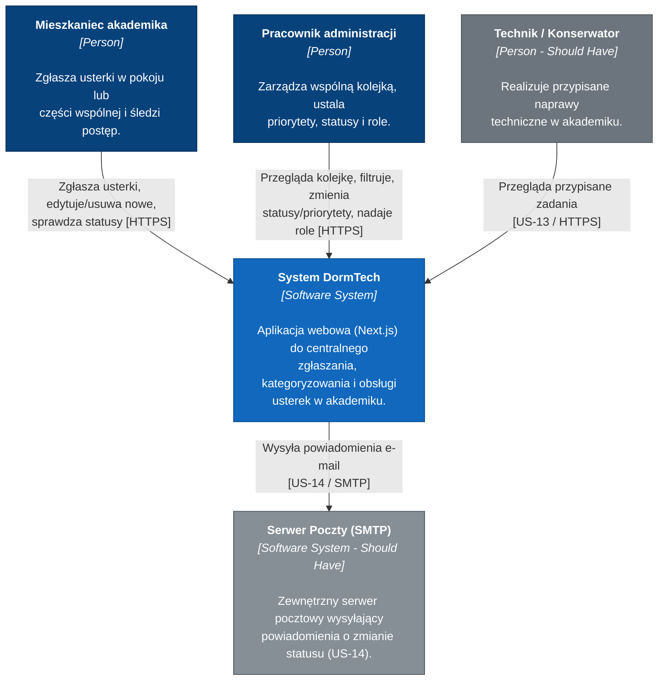
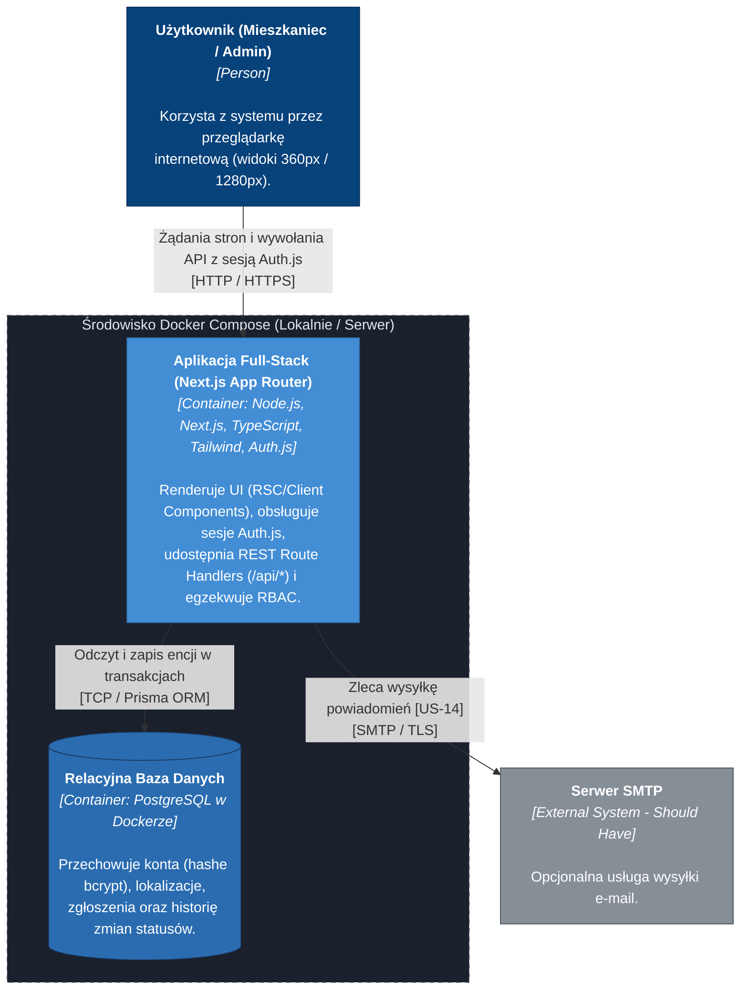
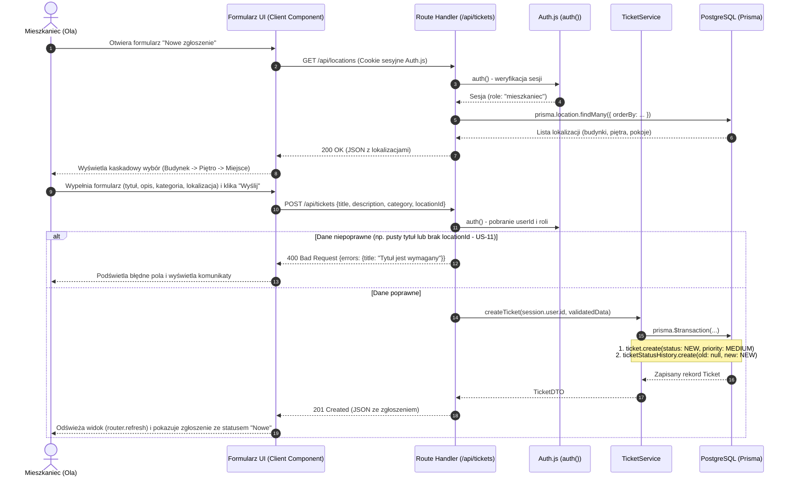
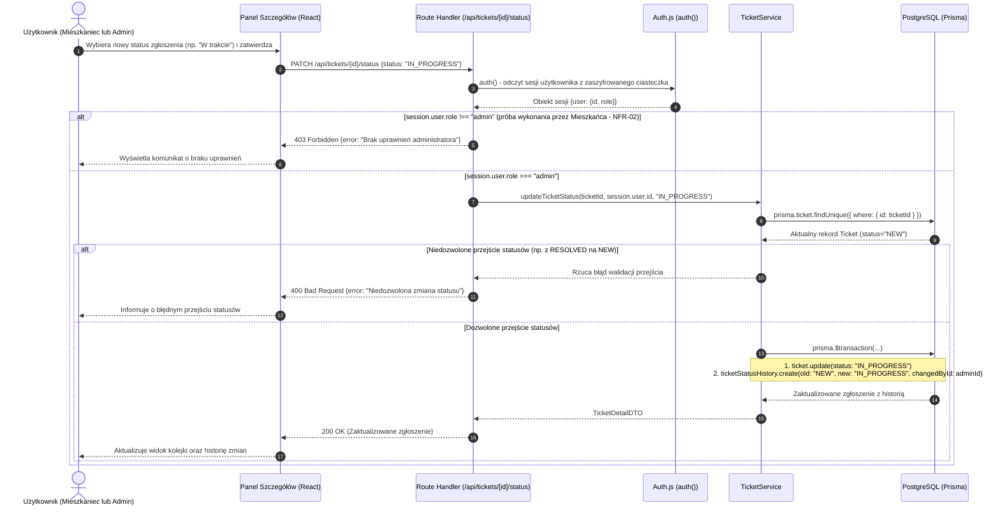

# DormTech — Dokument Architektury Systemu

**Zespół DMKSO**

**Wersja dokumentu:** 1.2

**Baza wymagań:** `Analiza_Wymagan.md` (priorytety MoSCoW)

## 1. Wprowadzenie i cel dokumentu

Niniejszy dokument opisuje architekturę systemu **DormTech** – aplikacji webowej służącej do zgłaszania, kategoryzowania i obsługi usterek w akademiku. Architektura została zaprojektowana tak, aby w pierwszej kolejności zrealizować wszystkie wymagania kategorii **Must Have (US-01 – US-11)** oraz wymagania niefunkcjonalne (**NFR-01 – NFR-06**), a jednocześnie pozostać otwartą na bezbolesne wdrożenie funkcji **Should Have** (komentarze, przypisywanie techników, powiadomienia e-mail) i **Could Have** (statystyki).

Wszystkie diagramy zamieszczone w dokumencie (zapisane w notacji Mermaid) odzwierciedlają docelową strukturę katalogów Next.js App Router, schemat bazy Prisma oraz kontrakty Route Handlers, zapewniając 100% zgodności z kodem źródłowym.

## 2. Styl architektury i uzasadnienie

### Wybrany styl: **Monolit Full-Stack oparty o Next.js App Router z architekturą warstwową**

#### Uzasadnienie wyboru:

1. **Spójność Full-Stack i brak narzutu komunikacyjnego (MVP):** Next.js (App Router) pozwala połączyć warstwę prezentacji (React Server/Client Components) z warstwą serwerową (Route Handlers `/api/*` oraz Server Actions) w jednym spójnym projekcie TypeScript. Eliminuje to konieczność utrzymywania dwóch osobnych repozytoriów/serwerów, konfiguracji CORS oraz duplikowania typów DTO.

2. **Łatwość uruchomienia lokalnego i odbioru (NFR-04):** Cały system składa się wyłącznie z dwóch kontenerów uruchamianych lokalnie jednym poleceniem `docker compose up` (aplikacja Next.js + baza PostgreSQL), bez uzależnienia od zewnętrznych platform chmurowych (brak Vercela na start). Gwarantuje to identyczne środowisko dla każdego członka zespołu i prowadzącego.

3. **Wyraźny podział odpowiedzialności (Separation of Concerns):** Mimo wspólnego frameworka, logika biznesowa jest odseparowana od warstwy HTTP/UI poprzez podział na: **Warstwę Prezentacji (`app/`)** $\rightarrow$ **Warstwę API (`app/api/`)** $\rightarrow$ **Warstwę Serwisów Domenowych (`src/services/`)** $\rightarrow$ **Warstwę Dostępu do Danych (`Prisma Client`)**.

4. **Gotowość na rozbudowę (Should/Could Have):** Modułowa organizacja serwisów domenowych pozwala łatwo dopisać obsługę komentarzy (`US-12`), przypisywanie techników (`US-13`) czy panel statystyk (`US-15` jako Server Component) bez refaktoryzacji rdzenia aplikacji.

## 3. Stos technologiczny i uzasadnienie

| Warstwa | Technologia | Uzasadnienie wyboru | 
| ----- | ----- | ----- | 
| **Framework Full-Stack (UI + API)** | **Next.js (App Router) + TypeScript** | Jeden spójny framework dla frontendu (React) i backendu (Route Handlers). Silne typowanie end-to-end między bazą danych, API a formularzami UI, wbudowany routing i ochrona tras przez `middleware.ts`. | 
| **Stylowanie UI** | **Tailwind CSS** | Szybkie budowanie spójnego, responsywnego interfejsu w podejściu *Mobile-First* bez przewijania poziomego dla szerokości `360px` i `1280px` (`NFR-06`). | 
| **Uwierzytelnianie i Sesje** | **Auth.js (NextAuth)** + `bcrypt` | Gotowa obsługa bezpiecznych sesji (zaszyfrowane ciasteczka `HttpOnly`), integracja z dostawcą `Credentials`, rozszerzenie obiektu sesji o role (`mieszkaniec` / `admin`) oraz ochrona przed atakami CSRF. Hasła hashowane `bcrypt` (`NFR-01`). | 
| **Baza danych** | **PostgreSQL (w Dockerze)** | Relacyjna baza danych gwarantująca integralność referencyjną (klucze obce między użytkownikiem, lokalizacją, zgłoszeniem a historią statusów – `NFR-03`) oraz szybką realizację zapytań filtrujących (`US-10`, `NFR-05`). | 
| **ORM i Migracje** | **Prisma ORM** | Deklaratywny schemat bazy danych (`prisma/schema.prisma`), wersjonowane migracje (`prisma migrate`), automatyczne generowanie typów TypeScript oraz wbudowane seedowanie danych startowych (`NFR-04`). | 
| **Konteneryzacja (Lokalnie)** | **Docker + Docker Compose** | Uruchomienie pełnego stosu (Next.js + PostgreSQL) lokalnie u całego zespołu i prowadzącego bez potrzeby zewnętrznego hostingu (bez Vercela na start). | 
| **CI / Jakość kodu** | **GitHub Actions** | Automatyczny potok CI uruchamiany na każdy Pull Request (PR): sprawdzanie typów (`tsc`), linter (`eslint`), weryfikacja migracji Prisma i testy. | 

## 4. Diagramy C4 (Kontekst i Kontenery)

### 4.1. Poziom 1: Diagram Kontekstu Systemu (C4 Context)

Diagram przedstawia system **DormTech** w otoczeniu jego użytkowników oraz zewnętrznych zależności (opcjonalny serwer SMTP dla powiadomień *Should Have*).



### 4.2. Poziom 2: Diagram Kontenerów (C4 Containers)

Diagram prezentuje architekturę uruchomieniową opartą o Docker Compose (bez zależności od Vercela) oraz logiczny podział wewnątrz kontenera aplikacji Next.js.



## 5. Model danych (ERD — Entity Relationship Diagram)

Model danych zdefiniowany w `prisma/schema.prisma` spełnia wymaganie **NFR-03** (co najmniej trzy powiązane encje z zachowaniem trwałości i historii zmian) oraz wspiera wszystkie historyjki *Must Have* (w tym wielopoziomowy wybór lokalizacji `US-04` oraz audyt zmian statusów `US-08`). Encja `TicketComment` oraz pole `assigned_to_id` są przygotowane pod wymagania *Should Have* (`US-12`, `US-13`).


### Kluczowe reguły integralności danych w Prisma / PostgreSQL:

* Usunięcie zgłoszenia przez mieszkańca (dozwolone wyłącznie w statusie `NEW` – `US-06`) usuwa kaskadowo (`onDelete: Cascade`) powiązane rekordy z `TICKET_STATUS_HISTORY`.

* Indeksy bazodanowe (`@@index`) zdefiniowane w `schema.prisma` na polach `status`, `category`, `authorId` oraz `createdAt` gwarantują czas filtrowania znacznie poniżej 2 sekund (`NFR-05`).

## 6. Diagramy sekwencji dla kluczowych wymagań Must Have

### 6.1. Scenariusz 1: Zgłoszenie usterki przez mieszkańca z walidacją i wskazaniem lokalizacji (`US-03`, `US-04`, `US-11`)

Diagram ilustruje pobranie lokalizacji, walidację danych wejściowych w Route Handlerze Next.js oraz transakcyjny zapis zgłoszenia (`prisma.$transaction`) wraz z pierwszym wpisem w historii statusów.



### 6.2. Scenariusz 2: Zmiana statusu zgłoszenia oraz weryfikacja uprawnień po stronie serwera (`US-08`, `NFR-02`)

Diagram pokazuje, w jaki sposób warstwa serwerowa Next.js weryfikuje sesję **Auth.js** i odrzuca próby modyfikacji statusu wykonywane przez mieszkańca (`403 Forbidden`), a dla roli `admin` realizuje transakcyjną zmianę statusu z zapisem historii.



## 7. Specyfikacja API (Next.js Route Handlers)

Endpointy zaimplementowane są jako **Next.js App Router Route Handlers** w katalogu `src/app/api/`. Sesja użytkownika weryfikowana jest po stronie serwera poprzez funkcję `auth()` z biblioteki **Auth.js** (ciasteczko sesyjne `HttpOnly`).

### 7.1. Uwierzytelnianie i Użytkownicy (`US-01`, `US-02`)

| Metoda | Ścieżka | Dostęp | Opis | Powiązane US | 
| ----- | ----- | ----- | ----- | ----- | 
| `GET/POST` | `/api/auth/[...nextauth]` | Publiczny | Wbudowane endpointy **Auth.js** (logowanie `Credentials`, wylogowanie, odczyt sesji `/api/auth/session`). | `US-01` | 
| `POST` | `/api/auth/register` | Publiczny | Rejestracja nowego konta z domyślną rolą `mieszkaniec` (`email`, `password`, `fullName`). Zwraca `201` lub `409 Conflict` (zajęty e-mail). | `US-01`, `US-11` | 
| `GET` | `/api/users` | `admin` | Pobiera listę wszystkich użytkowników systemu (do zarządzania rolami). | `US-02` | 
| `PATCH` | `/api/users/[id]/role` | `admin` | Zmienia rolę wskazanego użytkownika (`mieszkaniec` / `admin` / `technik`). Zwraca `403` dla nie-admina. | `US-02`, `NFR-02` | 

### 7.2. Lokalizacje (`US-04`)

| Metoda | Ścieżka | Dostęp | Opis | Powiązane US | 
| ----- | ----- | ----- | ----- | ----- | 
| `GET` | `/api/locations` | Zalogowany | Pobiera listę dostępnych budynków, pięter oraz pokoi/części wspólnych. Obsługuje opcjonalne query params: `?building=...&floor=...`. | `US-04` | 

### 7.3. Zgłoszenia usterek (`US-03`, `US-05` – `US-10`)

| Metoda | Ścieżka | Dostęp | Opis | Powiązane US | 
| ----- | ----- | ----- | ----- | ----- | 
| `POST` | `/api/tickets` | `mieszkaniec` | Tworzy nowe zgłoszenie ze statusem `NEW`. Waliduje obecność tytułu, opisu, kategorii i lokalizacji. | `US-03`, `US-04`, `US-11` | 
| `GET` | `/api/tickets` | Zalogowany | Pobiera listę zgłoszeń. Dla roli `mieszkaniec` filtruje automatycznie po `authorId == session.user.id`. Dla roli `admin` zwraca całą kolejkę. Obsługuje filtry query: `?status=...&category=...`. | `US-05`, `US-07`, `US-10` | 
| `GET` | `/api/tickets/[id]` | Właściciel lub `admin` | Pobiera szczegóły zgłoszenia wraz z lokalizacją oraz pełną historią zmian statusów. Zwraca `403`, jeśli `mieszkaniec` pyta o cudze zgłoszenie. | `US-05`, `US-07`, `NFR-02` | 
| `PATCH` | `/api/tickets/[id]` | Właściciel (`mieszkaniec`) | Edytuje `title`, `description`, `category` lub `locationId` własnego zgłoszenia. Dozwolone **wyłącznie**, gdy `status == NEW` (w przeciwnym razie `400`/`403`). | `US-06`, `US-11` | 
| `DELETE` | `/api/tickets/[id]` | Właściciel (`mieszkaniec`) | Usuwa własne zgłoszenie. Dozwolone **wyłącznie**, gdy `status == NEW`. | `US-06` | 
| `PATCH` | `/api/tickets/[id]/status` | `admin` | Zmienia status zgłoszenia (`NEW` $\rightarrow$ `IN_PROGRESS` $\rightarrow$ `RESOLVED` / `REJECTED`) i zapisuje wpis w `ticket_status_history`. | `US-08`, `NFR-02` | 
| `PATCH` | `/api/tickets/[id]/priority` | `admin` | Zmienia priorytet zgłoszenia (`LOW`, `MEDIUM`, `HIGH`, `CRITICAL`). | `US-09`, `NFR-02` | 

### 7.4. Endpointy przygotowane pod zakres *Should Have* (`US-12`, `US-13`)

| Metoda | Ścieżka | Dostęp | Opis | Powiązane US | 
| ----- | ----- | ----- | ----- | ----- | 
| `POST` | `/api/tickets/[id]/comments` | Właściciel lub `admin` | Dodaje komentarz do zgłoszenia. | `US-12` | 
| `PATCH` | `/api/tickets/[id]/assign` | `admin` | Przypisuje zgłoszenie do użytkownika z rolą `technik`. | `US-13` | 

## 8. Decyzje Architektoniczne (ADR — Architecture Decision Records)

### ADR-001: Wybór architektury monolitu Full-Stack (Next.js App Router) uruchamianego lokalnie przez Docker Compose (bez Vercela)

* **Status:** Zaakceptowano

* **Kontekst:** Zespół buduje aplikację MVP w określonym czasie projektu. System musi działać identycznie na komputerach wszystkich członków zespołu oraz prowadzącego (`NFR-04`), bez uzależnienia od zewnętrznych usług chmurowych (Vercel) i bez narzutu utrzymania osobnego backendu i frontendu.

* **Decyzja:** Zastosowanie frameworka **Next.js (App Router) + TypeScript** jako zintegrowanego monolitu (UI + Route Handlers `/api/*`), skonteneryzowanego w **Docker Compose** obok bazy **PostgreSQL**.

* **Konsekwencje:**

  * *Pozytywne:* Wspólne typy TypeScript między bazą (Prisma), API a interfejsem UI; uruchomienie całego systemu jedną komendą `docker compose up --build`; brak konieczności konfiguracji zewnętrznego hostingu na etapie MVP (z zachowaniem możliwości łatwego wdrożenia na Vercel lub VPS w przyszłości).

  * *Negatywne:* Warstwa UI i API skalują się razem w ramach jednego procesu Node.js (w pełni wystarczające przy skali akademika).

### ADR-002: Zarządzanie sesjami i kontrolą dostępu (RBAC) za pomocą Auth.js (NextAuth)

* **Status:** Zaakceptowano

* **Kontekst:** System wymaga bezpiecznego logowania (`US-01`), obsługi ról `mieszkaniec` oraz `admin` (`US-02`) i ścisłego egzekwowania uprawnień po stronie serwera (`NFR-02`).

* **Decyzja:** Wykorzystanie **Auth.js (NextAuth)** z dostawcą `Credentials`, strategią zaszyfrowanych ciasteczek sesyjnych JWT (`HttpOnly`, `SameSite=Lax`) oraz rozszerzeniem callbacków `jwt` i `session` o pole `role` i `id` użytkownika. Ochrona realizowana jest dwupoziomowo: przez `middleware.ts` (przekierowania stron) oraz jawną weryfikację `await auth()` w każdym Route Handlerze `/api/*` i serwisie domenowym.

* **Konsekwencje:**

  * *Pozytywne:* Odporność na kradzież tokenu przez XSS (brak tokenu w `localStorage`), wbudowana ochrona przed CSRF, pełna kontrola dostępu po stronie serwera niezależna od UI.

  * *Negatywne:* Zmiana roli użytkownika (`US-02`) wymaga ponownego zalogowania w celu odświeżenia danych w zaszyfrowanym ciasteczku sesyjnym – co jest wprost zgodne z kryterium akceptacji `US-02`.

### ADR-003: Audyt zmian statusów w dedykowanej tabeli relacyjnej (`ticket_status_history`) przy użyciu transakcji Prisma

* **Status:** Zaakceptowano

* **Kontekst:** Kryterium akceptacji `US-08` oraz wymóg trwałości `NFR-03` wymagają, aby każda zmiana statusu zgłoszenia zapisywała poprzedni status, nowy status, dokładny czas oraz osobę zmieniającą.

* **Decyzja:** Wydzielenie tabeli `ticket_status_history` w `schema.prisma` oraz wykonywanie aktualizacji zgłoszenia i dopisania wpisu historii wewnątrz atomowej transakcji `prisma.$transaction([...])`.

* **Konsekwencje:**

  * *Pozytywne:* Gwarancja spójności danych (nie da się zmienić statusu bez pozostawienia śladu w historii), gotowość danych do raportowania czasu rozwiązywania usterek (`US-15` – Could Have).

  * *Negatywne:* Nieznacznie większa liczba operacji zapisu podczas zmiany statusu.

### ADR-004: Automatyzacja weryfikacji jakości kodu przez GitHub Actions na Pull Requestach

* **Status:** Zaakceptowano

* **Kontekst:** Praca zespołowa nad wspólnym repozytorium wymaga ochrony głównej gałęzi (`main`) przed błędami kompilacji TypeScript, błędami lintingu lub niespójnym schematem bazy danych.

* **Decyzja:** Konfiguracja potoku **GitHub Actions** (`.github/workflows/ci.yml`), który uruchamia się automatycznie przy każdym otwarciu lub aktualizacji Pull Requesta (PR) i wykonuje: instalację zależności, `npx prisma validate`, `npm run lint`, `npm run typecheck` (`tsc --noEmit`) oraz `npm run build`.

* **Konsekwencje:**

  * *Pozytywne:* Wczesne wykrywanie regresji i niezgodności typów przed mergem kodu do `main`.

  * *Negatywne:* Kilkadziesiąt sekund oczekiwania na wynik sprawdzenia PR przed scaleniem zmian.

## 9. Realizacja wymagań niefunkcjonalnych (NFR)

| ID | Wymaganie | Sposób realizacji w architekturze | 
| ----- | ----- | ----- | 
| **NFR-01** | **Bezpieczeństwo haseł i sekretów** | Hasła hashowane są algorytmem `bcrypt` (cost factor = 10) przed zapisem przez Prismę. Sekrety (`DATABASE_URL`, `AUTH_SECRET`) trzymane są w lokalnym pliku `.env` wykluczonym w `.gitignore`; w repozytorium znajduje się wyłącznie plik `.env.example`. | 
| **NFR-02** | **Kontrola dostępu po stronie serwera (RBAC)** | Każdy Route Handler (`/api/tickets/*`, `/api/users/*`) wywołuje `const session = await auth()`, weryfikuje `session.user.role` (`mieszkaniec` vs `admin`) oraz własność zasobu (`ticket.authorId === session.user.id`). Próby nieuprawnionego odczytu, edycji lub zmiany statusu zwracają kod HTTP `403 Forbidden`. | 
| **NFR-03** | **Trwałość danych i relacje (min. 3 encje)** | Schemat `prisma/schema.prisma` definiuje 4 powiązane encje (`User`, `Location`, `Ticket`, `TicketStatusHistory`). Baza PostgreSQL w Docker Compose korzysta z nazwanego wolumenu (`postgres_data`), co gwarantuje zachowanie danych, identyfikatorów i historii po restarcie kontenerów. | 
| **NFR-04** | **Powtarzalne uruchomienie z README** | Konfiguracja `docker-compose.yml` automatycznie uruchamia bazę danych, wykonuje migracje (`npx prisma migrate deploy`), zasila bazę danymi startowymi (`npx prisma db seed` z kontami testowymi dla ról `mieszkaniec` i `admin`) oraz startuje serwer Next.js. | 
| **NFR-05** | **Wydajność filtrowania (< 2s dla 100 rekordów)** | Filtrowanie po statusie i kategorii realizowane jest przez zapytania SQL generowane przez Prismę (`where: { status, category }`) wsparte indeksami B-tree (`@@index`) w PostgreSQL. Czas odpowiedzi wynosi poniżej `50 ms`. | 
| **NFR-06** | **Responsywność i dostępność klawiatury (360px / 1280px)** | Interfejs zbudowany w **Tailwind CSS** w podejściu *Mobile-First* (elastyczne kontenery `w-full`, brak poziomego przewijania przy `360px` i `1280px`). Formularze wykorzystują semantyczne tagi HTML (`<label>`, `<input>`, `<select>`, `<textarea>`, `<button>`) z pełną obsługą nawigacji klawiaturą (`Tab`, `Enter`) i widocznym fokusem. | 

## 10. Struktura katalogów projektu (Gwarancja zgodności diagramów z kodem)

Struktura repozytorium odwzorowuje bezpośrednio podział z diagramów C4, modelu ERD oraz listy endpointów Route Handlers:

```
dormtech/
├── .github/
│   └── workflows/
│       └── ci.yml                       # GitHub Actions — potok CI na Pull Requestach (ADR-004)
├── docker-compose.yml                   # Kontenery: app (Next.js) + db (PostgreSQL) (C4 Level 2)
├── Dockerfile                           # Obraz kontenera aplikacji Next.js
├── .env.example                         # Szablon zmiennych środowiskowych (NFR-01)
├── README.md                            # Instrukcja uruchomienia i dane kont testowych (NFR-04)
├── docs/
│   ├── Analiza_Wymagan.md               # Analiza wymagań MoSCoW
│   └── Dokument_Architektury.md         # Niniejszy dokument architektury
├── prisma/
│   ├── schema.prisma                    # Definicja encji zgodna z diagramem ERD (Rozdział 5)
│   ├── migrations/                      # Wersjonowane migracje bazy PostgreSQL
│   └── seed.ts                          # Dane startowe (budynek, piętra, pokoje, konta mieszkaniec/admin)
└── src/
    ├── auth.ts                          # Konfiguracja Auth.js (NextAuth) — Credentials, sesje, role
    ├── middleware.ts                    # Ochrona tras UI (/dashboard, /admin) na podstawie sesji i roli
    ├── lib/
    │   └── prisma.ts                    # Singleton instancji PrismaClient
    ├── services/                        # Warstwa logiki biznesowej i egzekwowania reguł RBAC
    │   ├── ticket.service.ts            # Tworzenie, filtrowanie, edycja, usuwanie i zmiana statusów
    │   ├── location.service.ts          # Pobieranie hierarchii budynków, pięter i pokoi
    │   └── user.service.ts              # Rejestracja (bcrypt) i zmiana ról użytkowników (US-02)
    ├── components/                      # Komponenty UI (Tailwind CSS — responsywne 360px/1280px)
    │   ├── tickets/                     # Formularz zgłoszenia (US-03, US-04, US-11), filtry (US-10), lista
    │   └── layout/                      # Nawigacja z uwzględnieniem roli mieszkaniec / admin
    └── app/                             # Next.js App Router (Widoki + API)
        ├── (auth)/
        │   ├── login/page.tsx           # Strona logowania (US-01)
        │   └── register/page.tsx        # Strona rejestracji (US-01)
        ├── dashboard/                   # Panel mieszkańca (US-03, US-05, US-06)
        ├── admin/                       # Panel administracji: wspólna kolejka i role (US-02, US-07..US-09)
        └── api/                         # Route Handlers (Rozdział 7)
            ├── auth/
            │   ├── [...nextauth]/route.ts
            │   └── register/route.ts
            ├── locations/route.ts
            ├── users/
            │   ├── route.ts
            │   └── [id]/role/route.ts
            └── tickets/
                ├── route.ts
                └── [id]/
                    ├── route.ts
                    ├── status/route.ts
                    └── priority/route.ts
```